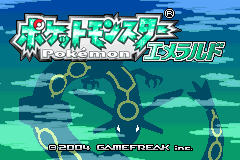

# GBAcapture (Nisekoro-capture) — 偽ころキャプチャ

*A DIY 60fps video + audio capture mod for the original Game Boy Advance, built on a
nanoCH32V305 (RISC-V). Documentation is in Japanese.*

初代ゲームボーイアドバンス（AGB-001）の**液晶信号と音声をデジタルのまま取り出す**
自作キャプチャシステム。いわゆる「偽トロキャプチャ」を、約1,000円のRISC-Vマイコンボード
**nanoCH32V305**（WCH CH32V305）でゼロから実装したもの。名前は偽トロ+作者HN「ころ」から。

**2026-07-05: 初キャプチャ成功！** 記念すべき一枚（黒線はUSB送信バッファの
上書きバグ。今となってはいい思い出）:


**2026-07-08: 完成形。** 60fps・クリアなステレオ音声・乱れゼロ。着工から3日:



## 特徴

- **映像**: 240×160 / 15bit RGB / **60fps**（フレーム落ちなし・実機と同一タイミング）
- **音声**: ステレオ。CPUの音声出力（SO1/SO2）から**プリボリューム**で取得
  — 本体の音量ホイールが0でもPCにはフル音量で流れる
- **ビューア**（Windows / C# / .NET 8）: ピクセルパーフェクト整数拡大(1x-4x)、
  アスペクト比維持フルスクリーン、スクリーンショット(F12)、音量調整、NO SIGNAL表示
- **録画**: OBSのウィンドウキャプチャ+デスクトップ音声でそのまま録画可能
- カーネルドライバ不要（WinUSB + 独自バルクプロトコル）
- **ボタンフリー開発**: 自作IAPブートローダによりFW更新はUSB経由で全自動（約10秒）

## 仕組み（概要）

```
GBA実機（基板の印字付きビア19本にタップ）
  ├ 映像: DCK(ドットクロック4.19MHz) + SPL(ライン同期) + RGB15bitパラレル
  │   → タイマ入力キャプチャ→DMA（サーキュラ）でクロック同期取り込み
  │   → VBLANK休止検出 + SPLによるハイブリッドフレーム同期
  ├ 音声: SO1/SO2 → RCフィルタ → 262kHz級ADC → PWMキャリア同期積分
  ▼
nanoCH32V305 ──USB High-Speed(480Mbps) バルク3EP──> Windowsビューア
```

技術的な要点（詳細は docs/ 参照）:

- 1ライン周期は実測 **DCK 241パルス**（可視240+ジャンク1）、1フレームは**161バースト**
  （可視160+VBLANK中のダミー1）— どちらも文献に無い実測知見
- ライン毎の割り込み処理はジッタの原因になるため排除（DMAは開始時に1回アームするだけ）
- USB-HSバルクは1EPあたり実効~3.3MB/s → 映像2EP+音声専用1EPに分離
- GBA音声のPWMキャリア（32.768kHzの整数倍）は、キャリア1周期分の箱型平均で厳密に除去

## リポジトリ構成

| パス | 内容 |
|---|---|
| `firmware/app/` | キャプチャFW本体（C, [ch32fun](https://github.com/cnlohr/ch32fun)） |
| `firmware/iap/` | 自作ブートローダ（USB経由の手放しFW更新） |
| `firmware/gba-pantest/` | L/R判定用の自作GBAテストROM |
| `host/GbaCap/` | コアライブラリ（パケット解析・デコード）+ xUnitテスト |
| `host/GbaCap.Viewer/` | ビューア本体（WinForms） |
| `host/GbaCap.Cli/` | 開発用CLI（FW更新・診断・静止画取得） |
| `docs/` | ドキュメント一式（配線・信号仕様・設計・トラブル記録） |

## 使い方（開発環境）

前提ツールは [docs/setup.md](docs/setup.md) 参照（.NET 8 / RISC-V GCC / wchisp など）。

```bash
# ホスト側テスト
cd host && dotnet test

# FWビルド → ボタンフリー更新
cd firmware && ./build.sh app
cd ../host && dotnet run --project GbaCap.Cli -- update ../firmware/app/gbacap_app.bin

# ビューア起動
host/GbaCap.Viewer/bin/Debug/net8.0-windows/GbaCap.Viewer.exe
```

ハード配線は [docs/wiring.md](docs/wiring.md)（GBA側は基板シルク印字のビアにタップ）と
[docs/gba-40pin-pinout.md](docs/gba-40pin-pinout.md) を参照。

## ドキュメント索引

- [docs/specification.md](docs/specification.md) — **仕様説明書**（人に説明するならまずこれ）
- [docs/capture-logic-invariants.md](docs/capture-logic-invariants.md) — 🔒 確定ロジックの不変条件（変更禁止事項）
- [docs/wiring.md](docs/wiring.md) — 配線表（正）と実機診断の記録
- [docs/gba-40pin-pinout.md](docs/gba-40pin-pinout.md) — 40ピンLCDコネクタの検証済みピン配置
- [docs/gba-video-signal.md](docs/gba-video-signal.md) — 映像信号仕様（実測値）
- [docs/audio-plan.md](docs/audio-plan.md) — 音声取得（SO1/SO2・RCフィルタ・キャリア同期積分）
- [docs/hands-free-loop.md](docs/hands-free-loop.md) — ボタンフリー開発ループ（IAP方式）
- [docs/flashing.md](docs/flashing.md) — 書き込み方式の検討経緯・救済手順
- [docs/architecture.md](docs/architecture.md) — 全体設計
- [docs/hardware-adapter-plan.md](docs/hardware-adapter-plan.md) — 基板化プラン
- [docs/recorder-plan.md](docs/recorder-plan.md) — スタンドアロン録画デバイス計画
- [docs/setup.md](docs/setup.md) — 開発環境の再現手順
- [docs/publishing-policy.md](docs/publishing-policy.md) — 公開時のコンテンツ方針

## ステータス / ロードマップ

- [x] 60fps映像キャプチャ + ビューア
- [x] クリアなステレオ音声（プリボリューム取得）
- [x] ボタンフリー開発基盤（IAP自己更新）
- [ ] スタンドアロン録画デバイス（[検討中](docs/recorder-plan.md)）
- [ ] UVC/UAC複合デバイス化（ドライバレスで任意のキャプチャソフト対応）
- [ ] 専用インターポーザ基板（32ピン/40ピン両対応）

## 公開について

このリポジトリは**テスト基板の開発記録として非公開のまま運用する方針**（2026-07-08決定）。
そのためREADMEやdocsはゲーム画面スクショ込みで自由に（日記帳的に）記録してよい。
もし将来、基板化版などを公開することになったら、その時は新規リポジトリを起こし
[docs/publishing-policy.md](docs/publishing-policy.md) に従ってコンテンツを選別する。
