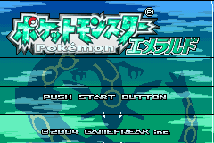

# GBA 偽トロキャプチャ (gba-capture)

Game Boy Advance の映像信号を nanoCH32V305 (WCH CH32V305, RISC-V) で取り込み、
USB-HS 経由で Windows PC にストリーミングする自作キャプチャシステム。

**2026-07-05: 初キャプチャ成功！**



```bash
cd host && dotnet run --project GbaCap.Cli -- capture out.bmp
```

## 構成

```
GBA (LCD信号タップ)
  │  15bit RGB パラレル + DCK/LP/SPS
  ▼
nanoCH32V305 (GPIO+DMAサンプリング → USB-HS バルク転送)
  │  USB Type-C (電源供給 + データ)
  ▼
Windows PC (専用キャプチャソフト)
```

- 解像度: 240×160、フレームレート: 59.7275 Hz、色深度: 15bit RGB (RGB555相当)
- 転送方式: USB-HS (480Mbps) バルク転送。約 4.6 MB/s なので帯域は十分
- 電源: USB Type-C から PC 給電（映像取得と同時）
- UVC 化は当面しない。まず「取得できる」ことが目標

## ディレクトリ

| パス | 内容 |
|---|---|
| `docs/` | 設計・配線・信号仕様・書き込み手順などのドキュメント |
| `firmware/` | CH32V305 ファームウェア (C, ch32fun ベース) |
| `host/` | Windows 側キャプチャソフト (C# / .NET 8, xUnit で TDD) |
| `.claude/skills/` | Claude Code 用スキル |
| `tools/` | wchisp・RISC-V GCC・ボード資料など（.gitignore 対象、docs/setup.md で再取得） |

## ドキュメント索引

- [docs/wiring.md](docs/wiring.md) — **配線表（正）**。GBA ↔ nanoCH32V305
- [docs/gba-40pin-pinout.md](docs/gba-40pin-pinout.md) — **40ピンLCDコネクタの検証済みピン配置**と正しいタップ位置
- [docs/gba-video-signal.md](docs/gba-video-signal.md) — GBA LCD 信号仕様
- [docs/architecture.md](docs/architecture.md) — キャプチャ方式・DMA設計・USBプロトコル
- [docs/hands-free-loop.md](docs/hands-free-loop.md) — **ボタンフリー開発ループ（IAP方式）の方法と手順**
- [docs/flashing.md](docs/flashing.md) — 書き込み方式の検討経緯・純正ISP調査記録・救済手順
- [docs/tdd.md](docs/tdd.md) — t-wada 流 TDD の運用ルール
- [docs/roadmap.md](docs/roadmap.md) — 将来計画（音声デジタル取得 / UVC / 録画デバイス）

## 開発の始め方

このリポジトリのルート (`C:\Users\korok\gba-capture`) で Claude Code を開くこと。
`CLAUDE.md` と `.claude/skills/` が読み込まれ、文脈が引き継がれる。
